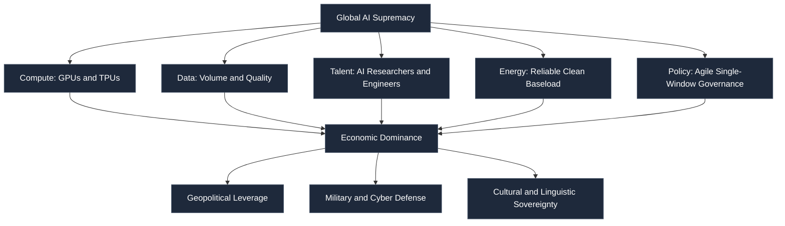
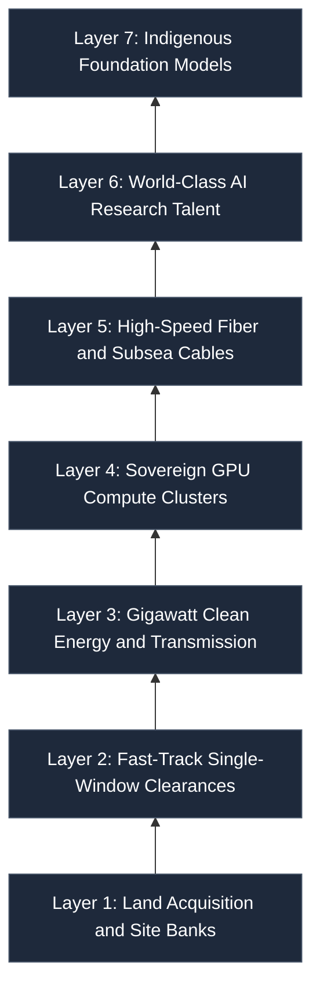
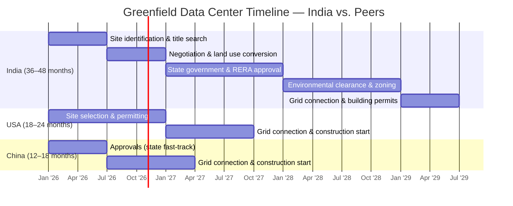
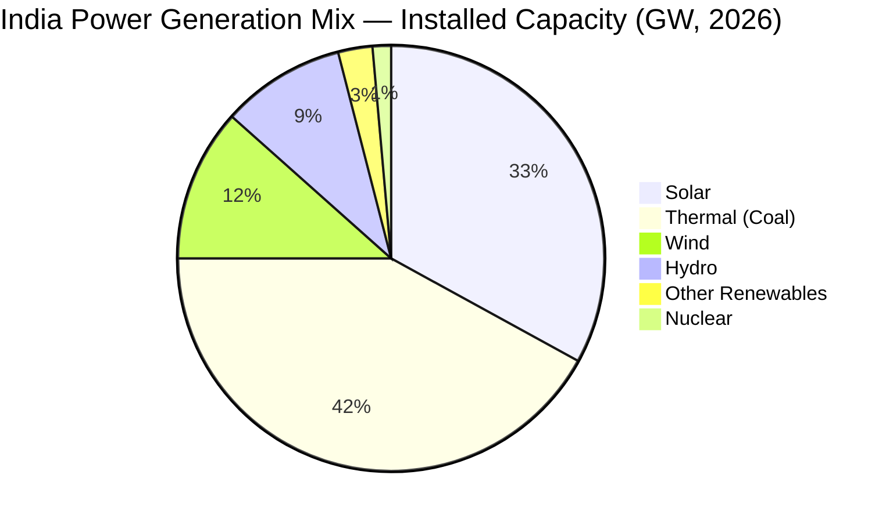
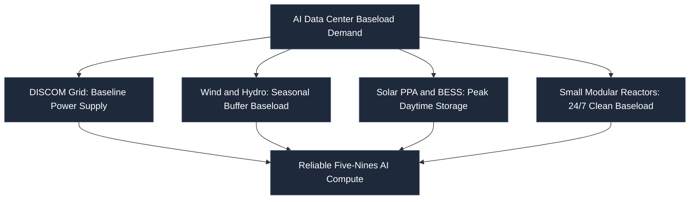
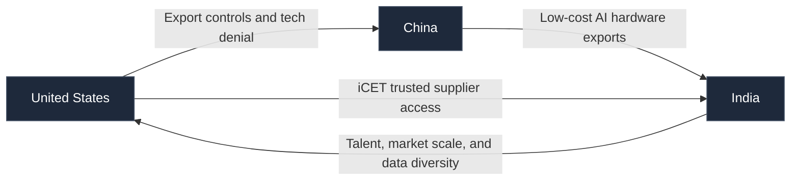
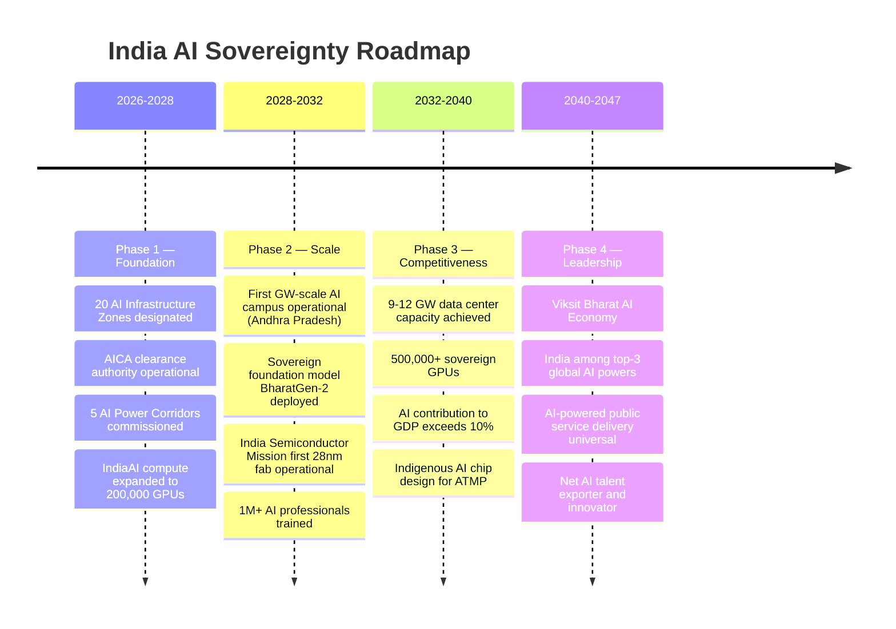

# INDIA IN THE AI ERA: FROM SILICON DREAMS TO SOVEREIGN POWER
## *A Strategic Forecast on India's Path to AI Superpower Status — Infrastructure, Policy, and the Race No Nation Can Afford to Lose*

---

> **Hackathon Research Paper · October 2026**
> **Author:** Parikshit Singh Bais
> **Domain:** AI Policy · Geopolitics · Digital Infrastructure · National Strategy

---

## TABLE OF CONTENTS

1. [Abstract](#abstract)
2. [The New Nuclear Race — Why AI Is the Most Important Technology of Our Time](#the-new-nuclear-race)
3. [Where India Stands Today — The Uncomfortable Truth](#where-india-stands-today)
4. [The Infrastructure Stack India Must Build](#the-infrastructure-stack)
   - [Layer 1: Land Acquisition](#layer-1-land-acquisition)
   - [Layer 2: Government Approvals & Regulatory Reform](#layer-2-government-approvals)
   - [Layer 3: Gigawatt-Scale Electricity](#layer-3-gigawatt-scale-electricity)
   - [Layer 4: Compute — GPUs, Servers & Data Centers](#layer-4-compute)
   - [Layer 5: Connectivity & Fiber Backbone](#layer-5-connectivity)
   - [Layer 6: Talent Pipeline](#layer-6-talent-pipeline)
5. [Geopolitical Dimension — The US–China Playbook & India's Opening](#geopolitical-dimension)
6. [A Phased Roadmap for India's AI Sovereignty (2026–2047)](#phased-roadmap)
7. [Key Metrics & Comparative Analysis](#key-metrics)
8. [Policy Recommendations](#policy-recommendations)
9. [Conclusion](#conclusion)
10. [References](#references)

---

## Abstract {#abstract}

The global race for Artificial Intelligence supremacy is the defining geopolitical contest of the 21st century — a contest whose consequences will be felt not just in defense ministries and boardrooms, but in every hospital ward, classroom, farm, and home. The nation that wins this race will not merely lead in one technology sector; it will reshape the global order in its image, controlling the intellectual infrastructure of modern civilization.

India stands at an extraordinary inflection point. Armed with the world's largest youth population, a formidable engineering talent pool, a booming startup ecosystem, and a democratic open-market framework coveted by Western technology partners — India has every *potential* asset to become a dominant AI power. Yet, potential means nothing without *infrastructure*.

This paper is an unflinching strategic forecast. It maps the physical, regulatory, and geopolitical hurdles India must overcome — from acquiring land for gigawatt-scale data centers to streamlining approval pipelines that today take years — and proposes a concrete, phased roadmap toward AI sovereignty by **Viksit Bharat 2047**.

> **Core Thesis:** *The AI race is India's Manhattan Project moment. The question is not whether India can compete — it is whether India will choose to move fast enough to matter.*

---

## The New Nuclear Race — Why AI Is the Most Important Technology of Our Time {#the-new-nuclear-race}

### The Historical Parallel

In 1945, the detonation of the first atomic bomb did not just end a war. It fundamentally restructured geopolitical power for the next eight decades. The nations that possessed nuclear capability joined an exclusive club of global decision-makers. Those who did not were, in the starkest terms, subjects of a world they could not shape.

**Artificial Intelligence is the atomic bomb of the 21st century** — with one critical difference. Its effects are not contained to warheads and deterrence. AI pervades every layer of human civilization:

| Sector | AI Application |
|--------|---------------|
| Healthcare | Drug discovery, diagnostics, robotic surgery |
| Agriculture | Precision farming, yield optimization |
| Defense | Autonomous systems, cyber warfare, ISR |
| Finance | Risk modeling, fraud detection, algorithmic trading |
| Education | Personalized learning at national scale |
| Manufacturing | Robotics, quality control, logistics |
| Governance | Policy simulation, resource allocation |
| Science | Protein folding, climate modeling, materials discovery |

### The Power Equation

Unlike nuclear technology — which required rare physical materials and was naturally contained — AI is built on **compute, data, and talent**. These are resources a nation can cultivate. But the window is closing. As AI models grow exponentially in capability, the compute infrastructure needed to train and run them is consolidating rapidly into the hands of a few players.

### Why the Race Is Already Underway

- **USA** has committed **$500B+** through private consortia (Stargate) and legislation (CHIPS Act) toward AI infrastructure
- **China** is spending an estimated **$15B+ annually** through state-backed AI funds, with mandated AI integration across all major industries
- **EU** launched a EUR 20B AI investment package with the AI Act establishing global regulatory standards
- **Saudi Arabia and UAE** are each committing $100B+ on AI cities and compute clusters in a bid to buy geopolitical relevance

**India?** The IndiaAI Mission, launched March 2024, carries an outlay of Rs. 10,371 crore (~$1.25B) over 5 years — roughly **0.25% of what the United States is spending.**

---

## Where India Stands Today — The Uncomfortable Truth {#where-india-stands-today}

### The Competitive Scorecard (2025–2026)

| Metric | USA | China | India | India's Target |
|--------|-----|-------|-------|----------------|
| AI Investment (cumulative) | ~$500B+ | ~$50B+ | ~$1.25B | $100B+ by 2030 |
| Data Center Capacity | ~65 GW | ~15 GW | ~1.5 GW | 9–12 GW by 2030 |
| Sovereign GPUs (state-held) | Millions | Millions | 18,000+ | 1M+ by 2030 |
| AI Researchers | ~45,000 | ~32,000 | ~8,000 | 100,000 by 2030 |
| AI Startups | ~10,000+ | ~6,000+ | ~3,500+ | 10,000 by 2030 |
| Semiconductor Capability | Full Stack | Partial Self-reliance | Early Stage | ATMP + Design by 2030 |

### India's Genuine Advantages (The Reason for Hope)

India is not starting from zero. It possesses structural advantages that *no other nation can replicate through policy alone:*

| Advantage | Detail | Strategic Value |
|-----------|--------|-----------------|
| **Talent Scale** | 4.3M software engineers; #1 global AI skill penetration rate | Unmatched human capital depth |
| **Diaspora Network** | ~4M Indian-origin professionals in US tech (Google, Microsoft, OpenAI CEOs) | Reverse-tech-transfer potential |
| **Digital Infrastructure** | 1.4B Aadhaar enrollments; UPI processing 13B+ transactions/month | World's largest real-time data system |
| **Renewable Energy** | 300 GW+ clean capacity by 2026; 500 GW target by 2030 | Clean power for AI data centers |
| **Geopolitical Position** | iCET with USA; G20 AI governance leadership; non-aligned trusted party | "Swing state" of the AI world |
| **Data Diversity** | 22 scheduled languages, 1.4B users across socioeconomic strata | Unmatched multilingual AI training data |
| **Market Scale** | 1.4B consumers — world's largest untapped AI addressable market | Self-sustaining AI economy potential |

---

## The Infrastructure Stack India Must Build {#the-infrastructure-stack}

Building AI sovereignty is not a single project — it is a **seven-layer infrastructure stack**, each layer a prerequisite for the next. India's current bottlenecks exist at every level.

---

### Layer 1: Land Acquisition {#layer-1-land-acquisition}

#### The Problem

Land is the bedrock of every AI data center. A **single gigawatt-scale AI campus** requires:
- **200–500 acres** of contiguous, flat land
- Proximity to **power substations** (within 5–10 km)
- Access to **fiber networks** (within 2–5 km)
- Adequate **water sources** for cooling (5–15 million liters/day)
- Distance from **seismic zones** and flood plains

India's fastest-growing data center hubs — **Mumbai, Hyderabad, Chennai, Pune, Noida** — are now critically land-constrained. In Mumbai's Navi Mumbai cluster, available industrial land near existing power infrastructure has been *entirely absorbed* by existing operators. Projects are now being pushed 80–150 km outward, creating connectivity and logistics cascades.

#### Land Acquisition Timeline: India vs. Competitors

#### Key Bottlenecks

1. **Fragmented land records** — Revenue records remain partially manual in many districts
2. **Panchayat Raj opposition** — Local governments resist "server farms" that appear to employ few locals
3. **Agricultural land conversion** — Legal complexity of converting farmland to industrial use
4. **Water rights disputes** — Data centers' cooling needs clash with agricultural water rights

> **Policy Intervention Required: "AI Infrastructure Zones (AIZ)"**
>
> Designate 20 pre-cleared, pre-approved AI Infrastructure Zones across India — analogous to Special Economic Zones (SEZs) — where land is aggregated, cleared, and offered to developers with **guaranteed grid connectivity and 90-day approval timelines.** States like Andhra Pradesh (Amaravati AI City), Telangana (Hyderabad ORR corridor), and Gujarat (GIFT City expansion) can lead this initiative.

---

### Layer 2: Government Approvals & Regulatory Reform {#layer-2-government-approvals}

#### The Approval Labyrinth

A single large-scale data center in India requires clearances from **14–22 distinct regulatory bodies.** The diagram below illustrates the full clearance tree:

```mermaid
flowchart TD
    classDef default fill:#1e293b,stroke:#475569,stroke-width:1px,color:#ffffff;
    ROOT["<span style='color:#ffffff'>100 MW Data Center Project</span>"] --> CL["<span style='color:#ffffff'>Central Approvals</span>"]
    ROOT --> SL["<span style='color:#ffffff'>State Approvals</span>"]
    ROOT --> LL["<span style='color:#ffffff'>Local Clearances</span>"]

    CL --> C1["<span style='color:#ffffff'>MeitY: Infrastructure Classification</span>"]
    CL --> C2["<span style='color:#ffffff'>MoEFCC: Environmental Clearance EIA</span>"]
    CL --> C3["<span style='color:#ffffff'>Ministry of Power: Interstate Grid Connectivity</span>"]
    CL --> C4["<span style='color:#ffffff'>DPIIT: Foreign Direct Investment Clearance</span>"]
    CL --> C5["<span style='color:#ffffff'>BIS: Structural and Seismic Compliance</span>"]

    SL --> S1["<span style='color:#ffffff'>State Industries: Industrial Land Allotment</span>"]
    SL --> S2["<span style='color:#ffffff'>State DISCOM: Power Wheeling Agreement</span>"]
    SL --> S3["<span style='color:#ffffff'>State PCB: Water and Air Consents NOC</span>"]
    SL --> S4["<span style='color:#ffffff'>State Fire Services: Fire Safety NOC</span>"]
    SL --> S5["<span style='color:#ffffff'>District Collector: Land Use Conversion</span>"]

    LL --> L1["<span style='color:#ffffff'>Municipal Corporation: Building Plan Sanction</span>"]
    LL --> L2["<span style='color:#ffffff'>Local Panchayat: No Objection Certificate</span>"]
    LL --> L3["<span style='color:#ffffff'>AAI: Airport Height Clearance</span>"]
```

Each body operates on different timelines, formats, and systems. Sequential dependencies make parallelization nearly impossible.

#### Benchmark: What Competitors Do

| Country | Average Approval Time | Key Mechanism |
|---------|----------------------|---------------|
| USA | 12–18 months | Federal permitting reform (FAST-41 Act) |
| China | 6–12 months | State council mandated fast-track |
| Singapore | 9–12 months | Single regulator: IDA/EDB |
| UAE | 6–9 months | ADGM/DIFC free zone authority |
| **India** | **36–60 months** | Fragmented, multi-body |

> **Proposed: "Mission AI-Clearance" — A Dedicated Fast-Track Authority**
>
> Establish a statutory body under PMO — the **AI Infrastructure Clearance Authority (AICA)** — with delegated powers from all relevant ministries to issue **composite AI infrastructure clearances within 90 days** for qualifying projects above 5 MW IT load.

---

### Layer 3: Gigawatt-Scale Electricity {#layer-3-gigawatt-scale-electricity}

#### The Power Demand Explosion

AI data centers are immensely power-hungry. The table below shows how rack power density has evolved:

| Infrastructure Type | Power per Rack | Equivalent City Load |
|--------------------|---------------|----------------------|
| Traditional server rack | 5–15 kW | — |
| Modern cloud rack | 20–40 kW | — |
| AI training rack (H100 GPUs) | 60–100 kW | — |
| Frontier AI rack (Blackwell) | 120–200 kW | — |
| **1 GW AI campus (aggregate)** | **1,000 MW** | **Surat or Coimbatore** |

India's data center capacity must grow from 1.5 GW (2025) to 9–12 GW (2030) — an **8x increase** in five years, requiring the equivalent of ten new gigawatt-scale power projects dedicated solely to AI.

#### India's Energy Mix (2026)

**Good news:** India crossed **300 GW of clean energy capacity** by mid-2026, five years ahead of schedule.

**Bad news:** Generation capacity does not equal reliable data center power. AI workloads require:
- **24/7 continuous power** — not intermittent solar or wind
- **99.999% uptime** — five-nines reliability
- **Instantaneous load ramp capability** — AI training can spike 20–40% in sub-minute bursts

#### Proposed Multi-Source Energy Strategy

**Nuclear is the linchpin.** Google's 1 GW AI campus in Andhra Pradesh is already structured around nuclear baseload. India's **SHANTI Act (2025)** allowing private nuclear investments including Small Modular Reactors (SMRs) is a watershed moment that must be accelerated.

> **Key Policy Action: "AI Power Corridors"**
> Designate 5 dedicated AI Power Corridors (AP, TN, MH, GJ, UP) where transmission infrastructure is pre-built to 5 GW capacity with Battery Energy Storage Systems (BESS) rated for AI load volatility, enabling same-year grid connection for qualified data center projects.

---

### Layer 4: Compute — GPUs, Servers & Data Centers {#layer-4-compute}

#### The GPU Gap

| Sovereign Entity | AI GPUs (2025 Estimates) | Global Compute Share | Relative Capacity Scale |
|:---|:---:|:---:|:---|
| **United States** | **4,000,000+** | 70.2% | `[||||||||||||||||||||]` (Global Benchmark) |
| **China** | **1,500,000+** | 26.3% | `[||||||||            ]` (Self-Reliant Challenger) |
| **European Union** | **200,000+** | 3.5% | `[|                   ]` (Regional Clusters) |
| **India** | **18,000+** | **0.3%** | `[<0.1                ]` (Critical Deficit) |

India holds approximately **0.45% of the compute power of the United States.** This is not merely an economic disadvantage — it is a **strategic vulnerability.** A nation that does not control its own AI compute:
- Cannot train foundation models on sensitive national data
- Cannot guarantee AI availability during geopolitical crises
- Cannot enforce data sovereignty regulations
- Cannot produce AI-enabled defense systems independently

#### The Data Center Architecture Challenge

| Feature | Traditional Data Center | AI Data Center |
|---------|------------------------|----------------|
| Power per rack | 5–15 kW | 40–200 kW |
| Cooling method | Air cooling | Liquid / immersion cooling |
| Network fabric | 10–100 Gbps | 400 Gbps–1.6 Tbps (InfiniBand/RoCE) |
| Floor loading | 500 kg/m² | 1,200–2,000 kg/m² |
| Construction cost | $5–8M per MW | $15–25M per MW |

#### Indigenous Semiconductor: The Long Game

India's **India Semiconductor Mission (ISM)** is building toward ATMP capability through:

- **Micron Technology** (Sanand, Gujarat) — DRAM packaging, operational 2025
- **Tata-PSMC** (Dholera, Gujarat) — 28nm chip fabrication, operational ~2026
- **CG Power-Renesas** (Sanand, Gujarat) — chip packaging

This is a start — but fabricating cutting-edge AI GPUs (3nm, 2nm) requires decades more investment and technology transfer. India's realistic near-term play is **chip packaging and design**, not frontier fabrication.

---

### Layer 5: Connectivity & Fiber Backbone {#layer-5-connectivity}

#### The Bandwidth Imperative

India's connectivity progress:
- **BharatNet Phase III:** Targeting optical fiber to all 600,000+ villages
- **Submarine cable landings:** 17+ cable systems landing at Mumbai, Chennai, Kochi
- **5G coverage:** 700+ cities by 2025; 740M+ users on 4G

**Gap:** Tier-2 and Tier-3 cities still have inadequate fiber for latency-sensitive AI applications. New AI data centers being pushed to periphery locations face connectivity deserts.

> **"AI Connectivity Fast Lane"**: Mandate that all new AI Infrastructure Zones receive dedicated 100 Gbps dark fiber rings with ring-topology redundancy as part of government infrastructure provisioning, funded through the Universal Service Obligation (USO) Fund.

---

### Layer 6: Talent Pipeline {#layer-6-talent-pipeline}

#### India's Crown Jewel — And Its Achilles' Heel

India's talent advantage is real and profound:
- **4.3 million software engineers** — world's 2nd largest pool
- **World's #1 ranked** nation for AI skill penetration rate (LinkedIn, 2025)
- **170% increase** in AI/ML role demand since 2024
- **2nd largest** contributor to public generative AI projects on GitHub

The demand-supply gap, however, threatens to swallow this advantage:

| Year | AI Talent Demand | Trained Supply | Gap |
|------|-----------------|----------------|-----|
| 2024 | 400,000 | 200,000 | -200,000 |
| 2025 | 700,000 | 280,000 | -420,000 |
| 2026 | 1,100,000 | 380,000 | -720,000 |
| 2027 | 1,400,000 | 500,000 | -900,000 |
| 2030 | 2,500,000+ | 900,000* | -1,600,000 |

*\*If current upskilling programs are maintained*

The paradox: India produces the world's AI talent — but for American and Chinese companies. India's brain drain is, in effect, a **subsidy to US and Chinese AI leadership.**

#### The Diaspora Dividend

India's approximately 4 million technology professionals in the US include:
- **Sundar Pichai** (Google/Alphabet CEO)
- **Satya Nadella** (Microsoft CEO)
- **Arvind Krishna** (IBM CEO)
- Indian-origin researchers at the core of OpenAI, Anthropic, and DeepMind

This diaspora represents an untapped **reverse-transfer channel.** India's AI policy must create conditions compelling enough to bring this talent home or keep it engaged with India's AI mission.

---

## Geopolitical Dimension — The US–China Playbook & India's Opening {#geopolitical-dimension}

### The Great Power AI Contest

### India's Unique Strategic Window

The US-China tech decoupling has created an extraordinary strategic opportunity for India that will not last indefinitely:

1. **"Friend-shoring" dynamics**: US companies are mandated to avoid Chinese supply chains. India is the only credible alternative at scale.

2. **iCET (Initiative on Critical and Emerging Technology)**: The 2023 US-India technology partnership enables India to access NVIDIA's advanced GPUs, TSMC fabrication partnerships, and US semiconductor equipment exports.

3. **QUAD Technology Working Group**: Semiconductor and AI supply chain collaboration with US, Japan, and Australia — nations with decades of advanced manufacturing expertise.

4. **G20 AI Governance Leadership**: India's 2023 G20 Presidency established the global AI Governance framework, positioning India as a *rule-setter* not a rule-taker.

### The Nuclear Doctrine Parallel — And Why It Applies to AI

When India tested nuclear weapons in 1974 and 1998, it faced international sanctions — but it joined the exclusive club of nations whose voices could not be ignored. India's nuclear doctrine of **"minimum credible deterrence"** was not about matching the US or China warhead-for-warhead. It was about establishing enough capability to be *geopolitically relevant.*

**India needs an AI equivalent:**
> *"Minimum Credible AI Sovereignty"* — Building enough indigenous AI infrastructure, models, and capabilities that India cannot be technologically coerced or excluded from critical systems.

This means:
- At least **one competitive sovereign foundation model** (BharatGen/Sarvam at scale)
- **500,000+ sovereign GPUs** by 2030
- **AI-powered defense systems** independent of foreign supply chains
- **Regulatory standards** that others must meet to access India's 1.4B-user market

---

## A Phased Roadmap for India's AI Sovereignty (2026–2047) {#phased-roadmap}

### Phase 1: Foundation (2026–2028) — "Clear the Path"

| Action | Agency | Timeline | Investment |
|--------|---------|----------|------------|
| Designate 20 AI Infrastructure Zones | DPIIT + MeitY | 12 months | Rs. 500 Cr |
| Establish AI Infrastructure Clearance Authority | PMO | 6 months | Rs. 200 Cr |
| Commission 5 AI Power Corridors | Ministry of Power | 24 months | Rs. 15,000 Cr |
| Expand IndiaAI GPU cluster to 200,000 GPUs | MeitY | 18 months | Rs. 8,000 Cr |
| National AI Upskilling Mission (1M engineers) | MoE + NASSCOM | 24 months | Rs. 2,000 Cr |
| Diaspora AI Engagement Program | MEA + MeitY | 12 months | Rs. 500 Cr |

**Phase 1 Outcome:** India reduces data center approval time from 4 years to 18 months. GPU count grows 10x.

### Phase 2: Scale (2028–2032) — "Build the Stack"

| Action | Agency | Timeline | Investment |
|--------|---------|----------|------------|
| Operationalize first 1 GW AI campus | PPP (State + Private) | 36 months | Rs. 50,000 Cr |
| BharatGen-2 foundation model at GPT-4 parity | IAIC | 24 months | Rs. 5,000 Cr |
| Tata-PSMC chip fab at full capacity | ISM | 36 months | Rs. 40,000 Cr |
| AI-in-Government: 100 departments | MeitY | 24 months | Rs. 3,000 Cr |
| Nuclear SMR pilot (2 x 300 MW) | DAE + Private | 48 months | Rs. 25,000 Cr |

### Phase 3: Competitiveness (2032–2040) — "Win the Market"

By this phase, India's domestic AI market should be self-sustaining:
- 500M AI service users (healthcare, agriculture, education, finance)
- AI contribution to GDP: **$500B+ annually**
- Indigenous AI used in **defense, space, nuclear programs**
- India becomes an AI model *exporter* to Global South nations

### Phase 4: Leadership (2040–2047) — "Shape the Rules"

India's **Viksit Bharat by 2047** vision requires AI leadership as a precondition:
- AI-optimized governance: Universal digital public services
- AI-powered manufacturing: World-class Industry 4.0 / 5.0
- AI-led science: Indian researchers leading in biology, materials, and climate
- **Global AI standards** shaped by India's regulatory framework

---

## Key Metrics & Comparative Analysis {#key-metrics}

### Investment Required

| Category | Investment Needed | Funding Source |
|----------|------------------|----------------|
| AI Infrastructure Zones (land, basic infra) | Rs. 2,000 Cr | Government |
| Power Infrastructure (corridors, transmission, BESS) | Rs. 80,000 Cr | PPP |
| Compute (GPUs, servers, cooling) | Rs. 1,50,000 Cr | PPP + FDI |
| Semiconductor Mission | Rs. 76,000 Cr | PPP + Subsidy |
| Talent Development | Rs. 10,000 Cr | Government |
| R&D (Foundation Models, AI Safety, Governance) | Rs. 25,000 Cr | Government |
| **Total Required (10 years)** | **~Rs. 3,43,000 Cr (~$41 Billion)** | |
| India's Current Commitment | Rs. 10,372 Cr (~$1.25B over 5 yrs) | Government |
| **Funding Gap** | **~30x underinvestment** | |

### GDP Multiplier Scenarios

| Scenario | 2030 | 2035 | 2040 | 2047 |
|----------|------|------|------|------|
| Base Case (current pace) | $50B | $150B | $350B | $600B |
| Accelerated Case (proposed roadmap) | $120B | $400B | $1.0T | $2.5T |
| Leadership Case (full AI economy) | $200B | $700B | $2.0T | $5.0T+ |

The difference between Base and Accelerated trajectories by 2047 is approximately **$2 Trillion** in additional economic value.

---

## Policy Recommendations {#policy-recommendations}

### 10 High-Impact Policy Actions

| # | Recommendation | Details |
|---|---------------|---------|
| 01 | **Establish AI Infrastructure Clearance Authority (AICA)** | PMO-level body with composite clearance power — 90-day approvals for all projects above 5 MW IT load |
| 02 | **Designate 20 AI Infrastructure Zones (AIZ)** | Pre-cleared, pre-powered, pre-connected land banks across 10 states for immediate developer uptake |
| 03 | **Mandate AI Power Corridors in 5 Key States** | Pre-built 5 GW transmission + BESS in AP, TN, MH, GJ, UP |
| 04 | **10x the IndiaAI Compute Budget** | From Rs. 10,000 Cr to Rs. 1,00,000 Cr over 5 years; targeting 1M+ sovereign GPUs by 2030 |
| 05 | **Fast-Track Nuclear SMR Deployment** | Operationalize first private SMR by 2030; target 10 GW nuclear for AI data centers by 2040 |
| 06 | **National AI Talent Emergency Program** | 1M AI engineers retrained by 2028; IIT/IISc PhD slots doubled; diaspora return incentives |
| 07 | **Sovereign AI Foundation Model Program** | Rs. 5,000 Cr to build BharatGen-2 at frontier scale with mandatory government use for national security data |
| 08 | **AI Diplomatic Offensive — Global South Leadership** | Export India's AI governance model and IndiaStack to 50 developing nations, creating an "AI Commonwealth" |
| 09 | **Semiconductor Mission 3.0 — Advanced Node Targets** | Partner with TSMC/Intel/Samsung for 7nm fabrication in India by 2032; design ATMP ecosystems at scale |
| 10 | **India AI Market Access Standards** | Use 1.4B-user market as leverage — any AI system operating in India must meet India's safety and data sovereignty standards, creating an "India Effect" in global governance |

---

## Conclusion {#conclusion}

The question India faces is not philosophical — it is existential and urgent.

In 1962, India lost a war partly because it lacked the technological and industrial base to equip and move its armed forces. In 1991, India came within days of sovereign default because it lacked economic sovereignty. Both crises triggered transformational change — Nehruvian industrial policy after 1962, and liberalization after 1991.

**AI is India's third such inflection point.**

The AI race is, at its core, an infrastructure race. It is won or lost not in research labs alone, but in the unglamorous work of clearing land, stringing transmission lines, building cooling towers, and cutting through bureaucratic red tape. It is won by the nation willing to treat AI infrastructure with the same urgency it once reserved for highway construction or nuclear development.

India has every structural advantage it needs: talent, data, market scale, democratic legitimacy, and a strategic position coveted by both Western and Global South partners. What it lacks is **velocity** — the institutional speed to turn these advantages into operational infrastructure before the window of competitive opportunity closes.

The good news: windows, unlike nuclear warheads, can be reopened. India's **youth demographic dividend** remains available for at least another 15–20 years. The global AI ecosystem is still in formation — standards, architectures, and supply chains are still being set. India can still shape these, rather than simply consume what others build.

But the clock is running. Every year of delay is not a neutral pause — it is active retreat from a race that does not wait.

> [!IMPORTANT]
> **The time for India's AI sovereignty is not 2030 or 2047. It is now.**

---

> *"Nations do not decide whether to join the AI race. They decide whether to compete — or to be governed by those who do."*
>
> — **Parikshit Singh Bais**

---

## References {#references}

1. **IndiaAI Mission Documentation** — Ministry of Electronics and Information Technology (MeitY), Government of India, 2024. Rs. 10,371.92 Cr outlay over 5 years; 18,000+ GPUs, 15 compute service providers empaneled.

2. **India Data Center Market Report 2025–2030** — JLL, CBRE, Cushman & Wakefield. Capacity projections from 1.5 GW (2025) to 9–12 GW (2030).

3. **India Semiconductor Mission (ISM 1.0 & 2.0)** — Ministry of Electronics & IT. Tata-PSMC (Dholera), Micron (Sanand), CG Power-Renesas partnerships; estimated $15B+ total investment.

4. **iCET — US-India Initiative on Critical and Emerging Technology** — White House Fact Sheet, 2023. AI and semiconductor cooperation framework between India and USA.

5. **SHANTI Act (2025)** — Enabling Private Nuclear Investment Including Small Modular Reactors, Government of India.

6. **India Ministry of New and Renewable Energy — Annual Report 2026** — 300 GW+ non-fossil capacity achieved July 31, 2026; solar at 165 GW, wind at 58 GW.

7. **National Single Window System (NSWS)** — Department for Promotion of Industry and Internal Trade. Investment approval digitization framework.

8. **LinkedIn Global AI Talent Report, 2025** — AI skill penetration by country; India ranked #1 globally. AI/ML role demand grew 170% since 2024.

9. **NASSCOM AI Workforce Report 2025** — Demand-supply gap analysis: 1.4M AI professionals needed by 2026; current supply ~380,000.

10. **Brookings Institution: "The US-China AI Competition"** — Strategic analysis of AI as geopolitical contest, 2024. CHIPS Act and export control analysis.

11. **IEA Data Centres & Data Transmission Networks Report 2024** — Global data center electricity at 415 TWh in 2024; projected 950–1,050 TWh by 2030.

12. **Google Andhra Pradesh AI Campus Announcement** — 1 GW AI infrastructure commitment, structured around clean/nuclear baseload energy.

13. **NVIDIA GPU Architecture Technical Specifications** — H100 and Blackwell series; 700W–1,200W TDP range; 40–200 kW per AI rack.

14. **Observer Research Foundation (ORF): "India's AI Geopolitics"** — Strategic positioning of India vis-a-vis the US-China competition, 2024–2025.

15. **Ministry of Power: Grid Modernization Report 2025–26** — BESS deployment, SCADA/EMS upgrades, transmission expansion for AI data center load integration.

---

*Prepared for Hackathon Research Competition · October 2026*

*This paper may be cited with attribution.*

---

**Author:** Parikshit Singh Bais  
**Domain:** AI Policy | Geopolitics | Digital Infrastructure | National Strategy
